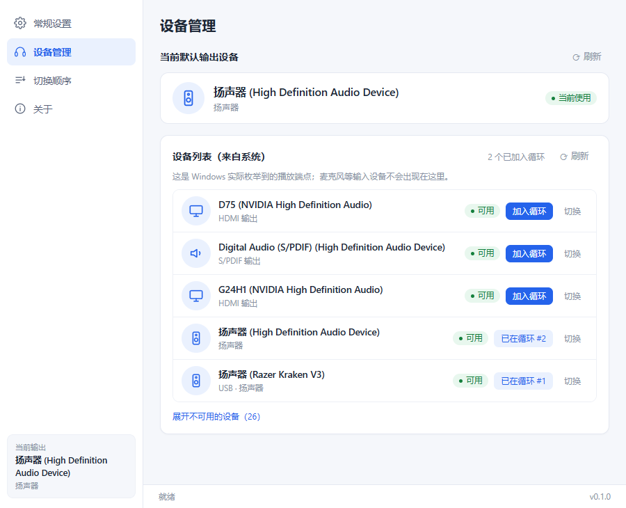
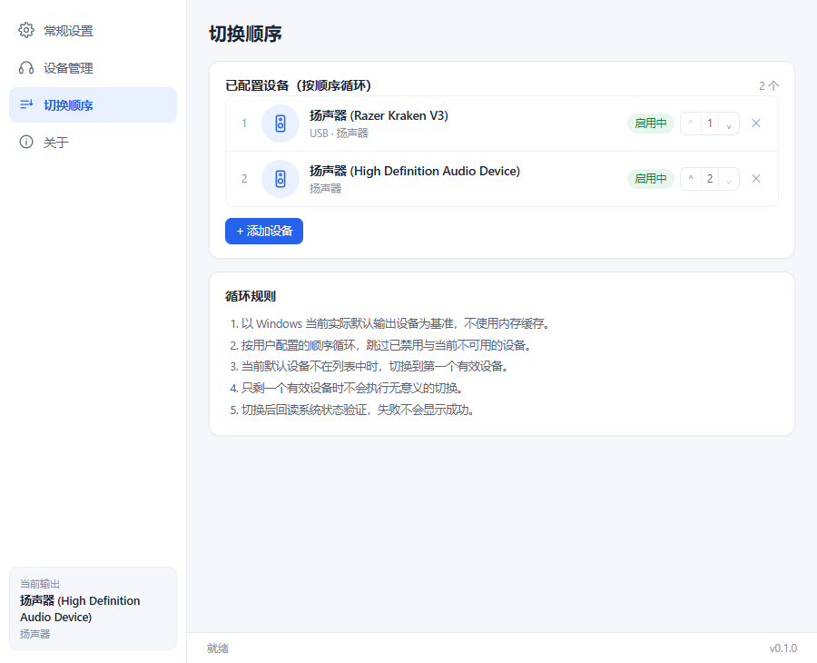
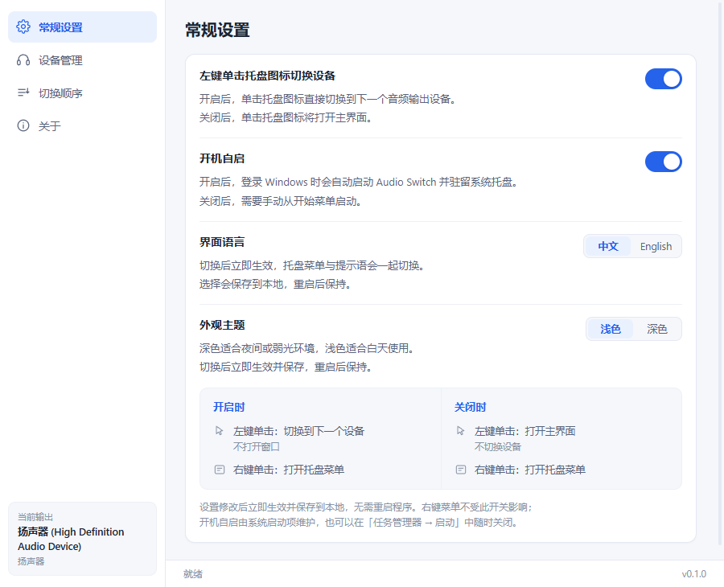
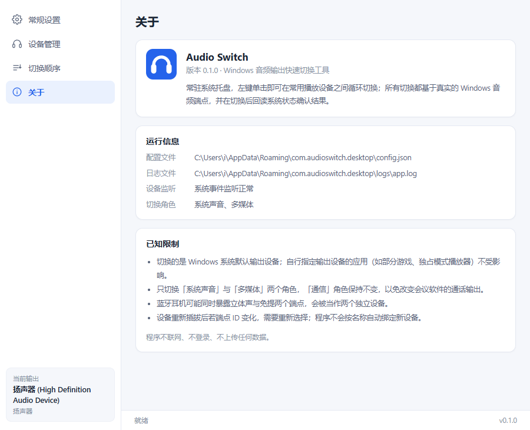

# Audio Switch

> 常驻系统托盘 · 一键切换 Windows 音频输出设备

左键单击托盘图标，就能在耳机、音箱、显示器、蓝牙耳机之间循环切换，不必再钻进「设置 → 系统 → 声音 → 更多声音设置」逐层点选。所有操作都基于真实的 Windows 音频端点，并在每次切换后**回读系统状态确认结果**。



## 项目简介

Windows 切换默认播放设备是一件高频但路径很长的事：耳机插上想切到耳机、开会想切回音箱、接上显示器又想走 HDMI。系统原生入口至少要三层点击，而第三方工具往往要常驻一个完整窗口。

Audio Switch 只做一件事：**把「切到下一个设备」变成一次点击**。

- 常驻托盘，关闭窗口即隐藏，不占用任务栏；
- 托盘左键按你定义的顺序循环切换，右键菜单可直接跳到某个设备；
- 切换通过系统内置的 `IPolicyConfig` 完成，并立即回读验证，失败会明确告诉你原因，而不是假装成功；
- 配置只保存「你想循环哪些设备、按什么顺序」，不保存任何运行时缓存。

| 项目 | 说明 |
| --- | --- |
| 桌面框架 | Tauri 2 + Rust |
| 前端 | Vue 3 + TypeScript + Vite（不引入 UI 框架，原生 CSS） |
| 音频 | Windows Core Audio / MMDevice API（`IMMDeviceEnumerator`、`IPolicyConfig`、`IMMNotificationClient`） |
| 目标系统 | Windows 10 1809+ / Windows 11（在 Windows 11 23H2 x64 上完成实测） |
| 许可证 | [MIT](LICENSE) |

## 功能特性

| 能力 | 说明 |
| --- | --- |
| 托盘一键切换 | 单击托盘图标切到循环顺序中的下一个设备，不弹窗、不打开主窗口 |
| 左键行为可配置 | 默认**左键打开主界面**（避免误触直接改掉正在播放的音频），可改为切换设备 |
| 右键菜单直达 | 当前输出 / 切换到下一个设备 / 已配置设备列表（点击即切）/ 设备配置 / 打开主界面 / 退出 |
| 四态托盘图标 | 正常、切换中、成功、失败四套真实图标资源；连续快速切换也不会卡在中间状态 |
| 真实设备枚举 | 列出系统实际存在的输出端点（含已禁用、未连接、已拔出），显示总线类型与端点形态 |
| 真实默认设备切换 | 修改系统默认输出端点，并回读验证后才判定成功 |
| 循环顺序自定义 | 手动排序、启用/禁用、移除；只对「已启用且当前可用」的设备循环 |
| 状态自动同步 | 设备插拔、状态变化、默认设备被外部修改后，自动刷新界面、菜单与 tooltip |
| 界面语言 | 中文 / English，托盘菜单与提示语一起切换，选择持久保存 |
| 外观主题 | 浅色 / 深色，即时生效并同步原生标题栏，选择持久保存 |
| 开机自启 | 可在设置中开启，状态以系统启动项回读为准 |
| 单实例 | 重复启动只激活已有窗口，不会出现第二个托盘图标 |
| 关闭即隐藏 | 关闭按钮仅隐藏到托盘，托盘菜单「退出」才真正结束进程 |
| 配置持久化 | `%APPDATA%\com.audioswitch.desktop\config.json`，损坏时自动备份并恢复默认 |

## 界面预览

| 设备管理 | 切换顺序 |
| --- | --- |
|  |  |

| 常规设置 | 关于 |
| --- | --- |
|  |  |

## 环境依赖

**运行**（仅使用安装包时）：

- Windows 10 1809+ 或 Windows 11（x64）
- WebView2 运行时（Windows 11 自带；Windows 10 若缺失，安装包会自动引导安装，需要联网）

**从源码构建**：

| 依赖 | 版本要求 | 说明 |
| --- | --- | --- |
| Node.js | ≥ 20（实测 22.22.2） | 前端构建 |
| Rust | stable（实测 1.96.0） | 需 `x86_64-pc-windows-msvc` 目标 |
| MSVC 生成工具 | VS 2022 Build Tools | 必须包含「使用 C++ 的桌面开发」工作负载与 Windows SDK |
| WebView2 运行时 | 任意较新版本 | 开发与运行都需要 |

安装 Rust 工具链（若尚未安装）：

```bash
rustup-init.exe -y --profile default --default-toolchain stable-x86_64-pc-windows-msvc
```

## 安装与使用

### 方式一：安装包（推荐）

1. 到 [Releases](https://github.com/233-3/AudioSwitch/releases) 下载最新的 `Audio Switch_<版本>_x64-setup.exe`；
2. 双击安装。安装范围是**当前用户**，不需要管理员权限，默认装到 `%LOCALAPPDATA%\Audio Switch`；
3. 安装完成后应用会自动启动并驻留托盘（蓝色耳机图标）。

> 安装包未做代码签名，首次运行时 Windows 可能弹出 SmartScreen 提示，选择「更多信息 → 仍要运行」即可。

### 方式二：从源码构建

```bash
git clone https://github.com/233-3/AudioSwitch.git
cd AudioSwitch

npm install                # 安装前端依赖
npm run tauri dev          # 开发模式：启动 Vite + Tauri 窗口，支持热更新
npm run tauri build        # 生产构建 + 打包 NSIS 安装程序
```

产物位置：

- 可执行文件：`src-tauri/target/release/audio-switch.exe`
- 安装包：`src-tauri/target/release/bundle/nsis/Audio Switch_0.1.0_x64-setup.exe`

> 打包时 Tauri 需要 NSIS。若 `%LOCALAPPDATA%\tauri\NSIS` 不存在且网络无法访问 GitHub，可手动准备：
>
> 1. 把 [nsis-3.13.zip](https://github.com/tauri-apps/binary-releases/releases/download/nsis-3.13/nsis-3.13.zip) 解压到 `%LOCALAPPDATA%\tauri\NSIS`（目录内应直接有 `makensis.exe`）；
> 2. 把 `nsis_tauri_utils.dll` 放到 `%LOCALAPPDATA%\tauri\NSIS\Plugins\x86-unicode\additional\`；
> 3. 重新执行 `npm run tauri build`。

中国大陆网络访问 crates.io 较慢时，可以在 `src-tauri/.cargo/config.toml` 里改用镜像（该文件不随仓库发布）：

```toml
[source.crates-io]
replace-with = "rsproxy-sparse"

[source.rsproxy-sparse]
registry = "sparse+https://rsproxy.cn/index/"

[net]
retry = 5
```

### 使用方式

**第一次打开**建议按这个顺序配置：

1. 进「设备管理」，在「设备列表（来自系统）」里把想参与循环的设备逐个「加入循环」；
2. 进「切换顺序」，按你希望切换的先后排序，不需要的可以禁用或移除；
3. 回到「常规设置」，决定左键单击托盘图标的行为（打开主界面 / 切换设备），并按需开启开机自启。

**日常使用**：

| 操作 | 效果 |
| --- | --- |
| 托盘左键单击 | 按设置：打开主界面（默认）或切换到下一个设备 |
| 托盘右键 | 打开菜单，可直接点某个已配置设备切换过去 |
| 关闭主窗口 | 隐藏到托盘，切换逻辑继续工作 |
| 托盘菜单 → 退出 | 保存配置并真正结束进程 |

界面分四页：

- **常规设置**：左键行为、开机自启、界面语言、外观主题；
- **设备管理**：当前默认输出 + 系统实际枚举到的全部输出端点；
- **切换顺序**：循环成员与顺序，附「循环规则」说明；
- **关于**：版本、配置与日志路径、监听状态、已知限制。

### 命令行诊断

不启动界面，直接输出真实设备枚举与切换结果，适合排查「设备找不到」「切换没生效」：

```bash
audio-switch.exe --diagnose                          # 列出所有输出端点与三个角色的默认端点
audio-switch.exe --diagnose --switch-next            # 按配置顺序切换一次，并回读验证
audio-switch.exe --diagnose --switch "<endpointId>"  # 直接切换到指定端点，并回读验证
```

退出码：`0` 成功 / `1` 失败 / `2` 参数错误 / `3` 无可用配置设备 / `4` 二次确认不一致。

## 配置与日志

| 内容 | 路径 |
| --- | --- |
| 配置文件 | `%APPDATA%\com.audioswitch.desktop\config.json` |
| 日志 | `%APPDATA%\com.audioswitch.desktop\logs\app.log` |
| 损坏备份 | `%APPDATA%\com.audioswitch.desktop\config.corrupt-<时间戳>.json` |

配置结构（`version` 为升级预留）：

```json
{
  "version": 1,
  "leftClickSwitch": false,
  "language": "zh",
  "theme": "light",
  "devices": [
    {
      "endpointId": "{0.0.0.00000000}.{xxxxxxxx-xxxx-xxxx-xxxx-xxxxxxxxxxxx}",
      "lastKnownName": "扬声器 (USB 游戏耳机)",
      "enabled": true
    }
  ]
}
```

- 数组顺序即用户定义的循环顺序；
- 不保存任何运行时状态（图标状态、切换锁、索引缓存都不会落盘）；
- `language` / `theme` 非法取值会在读取时自动回落到默认值；
- **开机自启不写入配置文件**，由系统启动项维护（注册表 `HKCU\...\CurrentVersion\Run`），界面显示的是回读到的真实状态；
- 单个设备断开不会被自动删除，只在界面上标记为不可用；
- 日志按 512 KB 轮转，保留 3 个历史文件，总占用约 2 MB。

## 目录结构

```
AudioSwitch/
├── index.html
├── package.json
├── vite.config.ts
├── tsconfig.json
├── docs/                             # 截图与架构说明
├── scripts/
│   └── generate-icons.mjs            # 图标生成脚本（SVG → PNG/ICO）
├── src/                              # 前端（Vue 3 + TS）
│   ├── App.vue                       # 外壳：侧栏导航 + 页面切换 + 状态栏
│   ├── i18n.ts                       # 中英文词表与当前语言（英文表必须写满同一批 key）
│   ├── main.ts
│   ├── env.d.ts
│   ├── styles.css                    # 全部样式与主题变量
│   ├── pages/
│   │   ├── GeneralPage.vue           # 常规设置（左键行为 / 开机自启 / 语言 / 主题）
│   │   ├── DevicesPage.vue           # 设备管理
│   │   ├── OrderPage.vue             # 切换顺序
│   │   └── AboutPage.vue             # 关于与运行信息
│   ├── components/
│   │   ├── SideNav.vue               # 左侧导航与当前输出概览
│   │   ├── DeviceIcon.vue            # 按端点形态渲染图标
│   │   ├── DeviceRow.vue             # 设备行
│   │   └── StatusBar.vue             # 版本与切换反馈
│   ├── composables/useAudioDevices.ts# 状态与后端事件同步
│   ├── services/audioService.ts      # 命令封装
│   └── types/audio.ts                # 与 Rust 快照对应的类型
└── src-tauri/                        # 后端（Rust）
    ├── Cargo.toml
    ├── build.rs
    ├── tauri.conf.json
    ├── capabilities/default.json
    ├── assets/tray/                  # 四态 × 16/20/24/32 px 托盘图标
    ├── icons/                        # 应用图标与 ICO
    └── src/
        ├── main.rs                   # 入口（诊断模式与界面模式分流）
        ├── lib.rs                    # 启动装配、事件去抖、降级轮询
        ├── audio/
        │   ├── mod.rs
        │   ├── types.rs              # 纯数据类型
        │   ├── error.rs              # 统一错误
        │   ├── com.rs                # 线程级 COM 初始化守卫
        │   ├── device.rs             # 端点枚举
        │   ├── default_endpoint.rs   # 默认设备读写 + 回读验证
        │   ├── policy_config.rs      # IPolicyConfig 显式 vtable 声明
        │   ├── cycle.rs              # 循环算法（纯函数 + 单元测试）
        │   └── watcher.rs            # IMMNotificationClient 监听
        ├── i18n.rs                   # 进程级语言与 Rust 侧文案
        ├── config.rs                 # 配置读写、校验、损坏恢复
        ├── state.rs                  # 运行时状态与前端快照
        ├── refresh.rs                # 状态同步与事件广播
        ├── switching.rs              # 切换流程编排与并发控制
        ├── tray.rs                   # 托盘图标 / tooltip / 菜单 / 点击
        ├── commands.rs               # 前后端命令
        ├── diagnose.rs               # --diagnose 命令行诊断模式
        ├── logging.rs                # 日志与轮转
        ├── window.rs                 # 窗口显示与主题
        └── shutdown.rs               # 退出清理
```

## 开发

```bash
npm run dev            # 仅前端（浏览器里打开 http://localhost:1420，无真实设备）
npm run tauri dev      # 完整桌面应用

npm run typecheck      # vue-tsc 类型检查
npm run build          # 类型检查 + 前端生产构建
npm run icons          # 重新生成图标（改动图形或配色后）

cd src-tauri
cargo fmt --check
cargo clippy --all-targets -- -D warnings
cargo test             # 单元测试：循环算法、配置读写与损坏恢复、托盘事件、i18n
```

实现细节（`IPolicyConfig` 显式 vtable、音频角色策略、循环算法、托盘事件处理、图标状态机、
设备监听降级、单实例与退出流程、双语架构）见 [`docs/ARCHITECTURE.md`](docs/ARCHITECTURE.md)。

架构与代码约定请在改动前阅读 [CONTRIBUTING.md](CONTRIBUTING.md)。

## 已知限制

1. **部分应用会自行指定输出设备**。切换系统默认设备不会改变这些程序的实际输出（例如某些游戏、播放器的独占模式、自带设备选择的应用），需要在应用内单独设置。
2. **Communications 角色不跟随切换**。会议/通话类软件可能仍使用原来的通信设备。
3. **同一物理耳机的多个端点**。蓝牙耳机常同时暴露「立体声」与「免提」两个端点，会被当作两个独立设备，本工具不会合并。
4. **共享端点的设备无法拆分**。3.5mm 耳机与机箱扬声器若共用同一个 Windows 端点，只能作为一个设备切换。
5. **端点 ID 变化需重新绑定**。设备重新插拔后若 `endpointId` 改变，旧配置会显示「已失效，请重新选择」，程序不会按名称自动匹配新设备。
6. **运行中改变显示器缩放比例**时，托盘图标沿用启动时选择的像素尺寸，重启后恢复最佳匹配。
7. **不支持全局快捷键、应用级音频路由、云同步**（当前版本刻意不做）。

## 贡献

欢迎 Issue 与 PR。提交前请先读 [CONTRIBUTING.md](CONTRIBUTING.md)，其中包含报告问题的信息清单、代码约定与提交前检查命令。

- 报告缺陷：请附上 `audio-switch.exe --diagnose` 的输出与 `logs\app.log` 相关片段；
- 提交改动：一个 PR 只做一件事，说明动机与验证方式；
- 行为变化请同步更新 [CHANGELOG.md](CHANGELOG.md)。

## 联系方式

- 缺陷与功能建议：优先使用 [GitHub Issues](https://github.com/233-3/AudioSwitch/issues)（便于追踪与检索）；
- 其他交流：可以在 Issue 中 @ 维护者 [@233-3](https://github.com/233-3)。

## 许可证

[MIT](LICENSE) © 2026 QKSAMA

本项目不联网、不登录、不上传任何数据；日志只记录设备名称、端点 ID、切换结果等本地运行信息。
